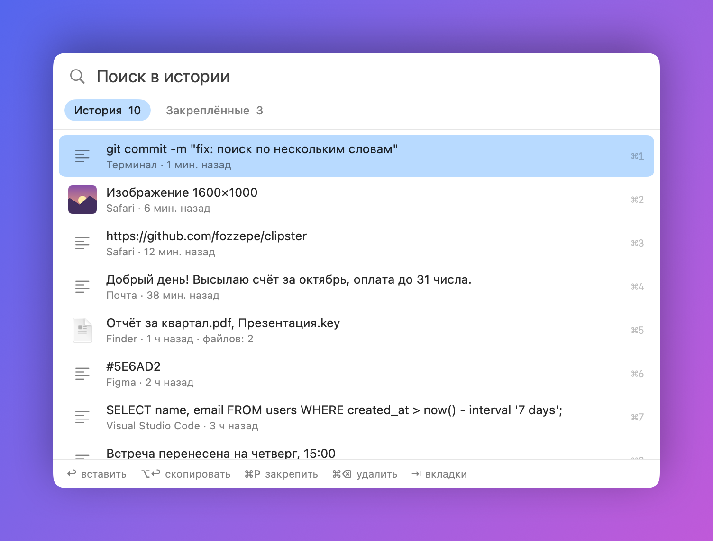
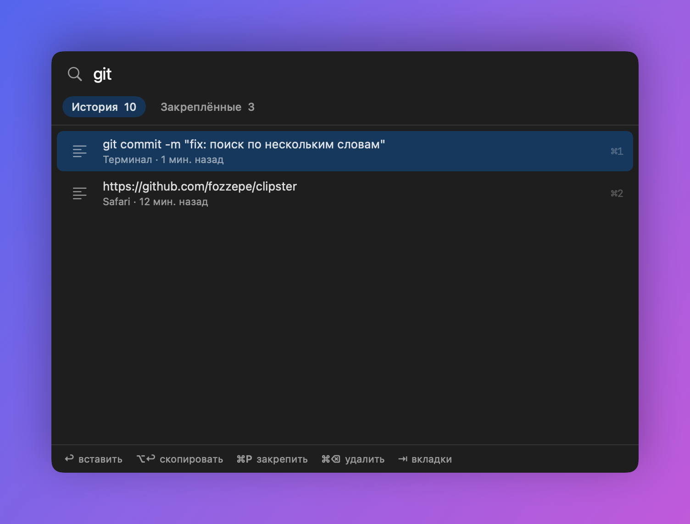
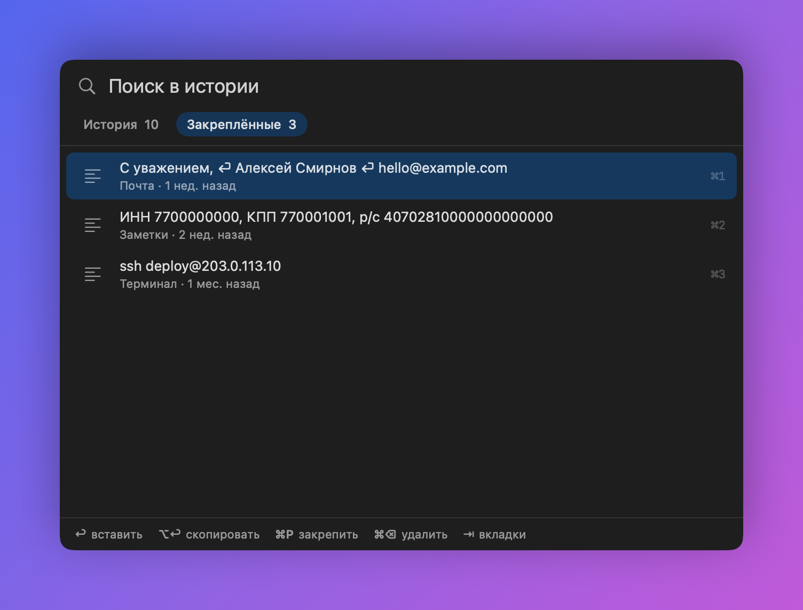
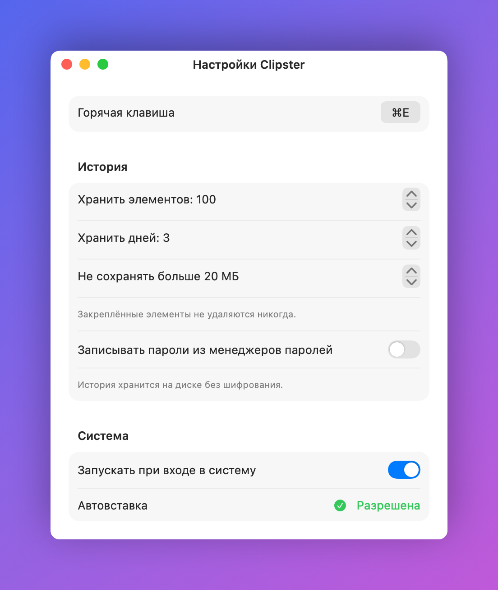

# Clipster

[Русская версия](README.md)

A tiny clipboard history manager for macOS. Everything you copy — text, images, files from Finder — stays one keystroke away.

Press **⌘E**, type to search, hit **Return**, and it's pasted into the app you were in.



- ~1,100 lines of native Swift (AppKit + SwiftUI), no dependencies
- Builds without Xcode: Command Line Tools are enough
- Universal binary (Apple Silicon + Intel), macOS 14+
- Vibe-coded in one evening with [Claude Code](https://claude.com/claude-code)

> The UI is in Russian for now.

## Install

Open Terminal (⌘ Space, type "Terminal", Enter), paste this line and press Enter:

```bash
curl -fsSL https://raw.githubusercontent.com/fozzepe/clipster/main/install.sh | zsh
```

It downloads the latest release, puts Clipster in Applications and launches it. No password needed, and no "unidentified developer" warning, because files fetched with curl aren't quarantined. See [install.sh](install.sh) for exactly what it does.

Then allow Clipster in **System Settings → Privacy & Security → Accessibility**. Without it Clipster can only copy, not auto-paste.

**Without Terminal:** download `Clipster.zip` from [Releases](../../releases/latest), unzip, move `Clipster.app` to Applications, launch it, then go to **System Settings → Privacy & Security → Open Anyway**. The app isn't notarized (that takes a paid Apple Developer account).

**Update:** run the same command again. If auto-paste stops working after an update, remove Clipster from the Accessibility list with "−" and relaunch it.

**Build it yourself:**

```bash
xcode-select --install   # if you don't have Command Line Tools yet
./build.sh --install
```

## Keys

<p>
  
  
</p>

| Key | Action |
|---|---|
| ⌘E | Open / close history (change it in Settings) |
| typing | Search by words, any order, case-insensitive |
| ↑ ↓ | Move selection |
| Return | Paste into the active app |
| ⌥ Return | Copy only |
| ⌘1 … ⌘9 | Paste item by number |
| ⌘P | Pin / unpin |
| ⌘⌫ | Delete item |
| Tab | History ↔ Pinned |
| Esc | Close |

## Defaults

<p align="center"></p>

- Keeps the last 100 items, nothing older than 3 days, nothing larger than 20 MB. Pinned items are kept forever.
- Passwords copied from password managers (1Password, Bitwarden, Apple Passwords) are **not** recorded. You can turn that on in Settings.
- History is stored unencrypted in `~/Library/Application Support/Clipster/`.
- Launches at login. The global ⌘E shortcut overrides "Use Selection for Find" in other apps.

## License

[MIT](LICENSE)
